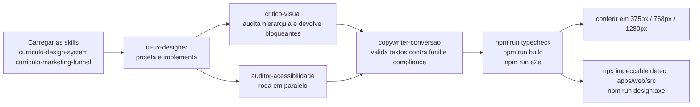

# DESIGN — camada de UI/UX

Documento-**ponte**. A camada de design deste projeto **não** vive aqui: ela é
mantida em dois lugares canônicos, e este arquivo existe para que quem lê a
documentação de arquitetura encontre o caminho certo sem duplicar regra.

> **Não duplique regra de design neste arquivo.** Se uma decisão de token, cor,
> funil ou acessibilidade precisa mudar, mude na skill ou em
> `docs/design/estrategia-marketing.md` — e a mudança vale para todo o projeto.
> Duas fontes de verdade sobre a mesma regra foi exatamente o que produziu o
> defeito de contraste documentado abaixo.

## 1. Onde a regra de design vive

### 1.1 Skills carregáveis — `.dsh/skills/`

São a **fonte de verdade** de tokens, funil e protocolo de revisão. `AGENTS.md`
determina que sejam carregadas **antes de mexer em qualquer interface**.

| Skill | Caminho | Use para |
|---|---|---|
| `curriculo-design-system` | `.dsh/skills/curriculo-design-system/SKILL.md` | Tokens, cores semânticas do Termômetro, tipografia, espaçamento, acessibilidade |
| `curriculo-marketing-funnel` | `.dsh/skills/curriculo-marketing-funnel/SKILL.md` | Gancho → Promessa → Prova → CTA; compliance jurídico da copy |
| `curriculo-hero` | `.dsh/skills/curriculo-hero/SKILL.md` | Padrão da home/hero e busca de números reais |
| `curriculo-design-review` | `.dsh/skills/curriculo-design-review/SKILL.md` | Auditar uma UI antes de considerá-la pronta |

> **Skills de domínio:** além das skills de design acima, existem quatro em
> `.claude/skills/`, confirmadas no repositório: `curriculo-idip`,
> `curriculo-data-pipeline`, `curriculo-infra` e `curriculo-juridico`. Elas são de
> **domínio** (fórmula, pipeline, infraestrutura, jurídico), não de interface —
> mas `curriculo-idip` é citada em `apps/web/src/app/page.tsx` como a razão de não
> se inventar metodologia para preencher um cartão, e `curriculo-juridico` é
> relevante para qualquer copy. Leia-as antes de mudar fórmula ou texto jurídico.

### 1.2 Estratégia consolidada — `docs/design/`

| Arquivo | Conteúdo |
|---|---|
| [`docs/design/estrategia-marketing.md`](../design/estrategia-marketing.md) | Funil de 4 estágios, a dor central do público, o que foi removido da home e por quê, regras inegociáveis |
| [`docs/design/agents/`](../design/agents/) | Briefs autossuficientes de subagentes de design |
| [`docs/design/avaliacao-ferramentas.md`](../design/avaliacao-ferramentas.md) | Avaliação de ferramentas de design |
| [`docs/design/avaliacao-bibliotecas-animacao.md`](../design/avaliacao-bibliotecas-animacao.md) | Avaliação de bibliotecas de animação (o projeto resolve com CSS + Tailwind) |

**Os briefs em `docs/design/agents/` permanecem onde estão** e não devem ser
movidos: são referenciados por `AGENTS.md` e por
`docs/design/estrategia-marketing.md`. São autossuficientes e feitos para
delegação com contexto isolado — o subagente não compartilha o contexto da sessão
que o chamou, então o brief precisa ser passado **inteiro** mais os arquivos-alvo.

| Brief | Papel na ordem de trabalho |
|---|---|
| [`ui-ux-designer.md`](../design/agents/ui-ux-designer.md) | 1 — projeta e implementa a mudança |
| [`critico-visual.md`](../design/agents/critico-visual.md) | 2 — audita hierarquia e qualidade visual, devolve bloqueantes |
| [`auditor-acessibilidade.md`](../design/agents/auditor-acessibilidade.md) | 3 — roda em paralelo com o crítico; audita WCAG 2.2 AA e responsividade |
| [`copywriter-conversao.md`](../design/agents/copywriter-conversao.md) | 4 — valida os textos contra o funil e o compliance jurídico |

### 1.3 Implementação — onde as decisões viram código

| Peça | Caminho | O que contém |
|---|---|---|
| Tokens e regras globais de acessibilidade | `apps/web/src/app/globals.css` | `@theme` (movimento), `@layer base` (reduced-motion, `:focus-visible`, sublinhado de link em texto corrido), utility `link-sem-sublinhado` |
| Aparência dos estados do Termômetro | `apps/web/src/lib/status-visual.ts` | Fonte única de cor, emoji, rótulo e descrição dos 4 estados de `ReliabilityStatus` |
| Superfície de tema | `apps/web/src/app/layout.tsx` | Tema **dark fixo** (`bg-slate-950` no `<body>`), header, navegação, rodapé |
| Teste de acessibilidade | `tests/e2e/acessibilidade.spec.ts` | axe-core com a tag **`wcag22aa`** em home, ranking e metodologia |

## 2. As regras que não se negociam

Consolidadas do `AGENTS.md` (regras de produto) e de
`docs/design/estrategia-marketing.md` (regras inegociáveis). Elas não são
preferência: cinco delas têm verificação automatizada.

| # | Regra | Verificação |
|---|---|---|
| 1 | **Cores de estado derivam de `enum ReliabilityStatus`** (`GREEN`/`YELLOW`/`RED`/`GRAY`). Nunca use verde/âmbar/vermelho fora desse significado; nunca use azul/roxo para um estado | `apps/web/src/lib/status-visual.ts` é a única fonte; `Termometro.tsx` e a home importam dela |
| 2 | **Linguagem jurídica estrita** — só "Réu em Ação Penal" e "Condenação Transitada em Julgado"; nunca "crime" sem trânsito em julgado | Revisão humana + [LEGAL_TERMS.md](../01-product-discovery/LEGAL_TERMS.md) |
| 3 | **Nenhum número exibido sem consulta real ao banco**, e a faixa de prova **desaparece** quando não há dado — nunca "0 políticos avaliados" | `apps/web/src/lib/hero-stats.ts` devolve `null`; `HeroStats.tsx` aplica o corte; `tests/e2e/home.spec.ts` |
| 4 | **A votação popular nunca altera a nota, e a UI não pode sugerir o contrário** | Aviso explícito em `/ranking/personalizado`; rodapé do site; [ADR-011](ADR.md#adr-011) |
| 5 | **Acessibilidade AA é requisito, não melhoria** | `tests/e2e/acessibilidade.spec.ts`, gate no `.github/workflows/a11y.yml` |
| 6 | **Um único CTA primário por seção** | `tests/e2e/home.spec.ts` assere exatamente um CTA primário na home |
| 7 | **Nenhum peso é redigitado na UI** | `apps/web/src/lib/methodology.ts` + teste WEB-001 |

## 3. Três defeitos reais que viraram regra

Registrados aqui porque cada um gerou uma proibição concreta no projeto — e todos
foram encontrados por verificação, não por revisão estética.

### 3.1 A UI divergiu da própria fórmula (`v1.0` vs `v1.1`)

A home exibia "Metodologia IDIP v1.0" com Produção 20% e Custo/Benefício 5%
enquanto o motor já rodava **v1.1** (18% e 7%).

**Por que isso é o pior defeito possível neste produto:** o diferencial declarado
é "algoritmos abertos" e "neutralidade algorítmica". Se a home anuncia uma versão
da fórmula que o motor não executa, a plataforma perde exatamente o que vende.
É **defeito de credibilidade, não de design**.

**Regra derivada:** os pesos exibidos vêm de `methodology.ts`, que é conferido
contra `WEIGHTS` do motor pelo teste **WEB-001** em `verify-scoring.ts` — que
também exige cobertura de **todas** as dimensões (uma omissão faria os pesos não
fecharem em 100%). Mudar a fórmula exige editar `scoring.ts` **primeiro**.
Ver [ADR-005](ADR.md#adr-005).

### 3.2 O CTA da home reprovava em contraste (2,71:1)

Texto branco sobre `bg-sky-500` dava **2,71:1** — reprovado em AA (mínimo 4,5:1
para texto normal). A correção foi `text-slate-950` sobre `sky-500` = **7,45:1**.
O teste agora mede o contraste a partir do estilo computado, então a regressão é
impossível:

```
// tests/e2e/home.spec.ts
expect(razao).toBeGreaterThanOrEqual(4.5);
```

**Regra derivada:** o texto do botão primário é `text-slate-950`, **nunca**
`text-white`. Se precisar de texto branco sobre azul, o fundo tem de ser `sky-700`
ou mais escuro (5,86:1); `sky-600` dá 4,02:1 e serve só para texto grande.

### 3.3 `text-slate-500` era usado como texto em 167 lugares (4,23:1)

Medido: **4,23:1** sobre `slate-950` e **3,74:1** sobre `slate-900` — reprovado em
AA para texto normal. Todos os 167 usos foram corrigidos para `text-slate-400`
(7,66:1 e 6,78:1). O detector (`npx impeccable detect apps/web/src`) aplica esse
limite e reprova com exit 2.

**Regra derivada:** `text-slate-500` é **proibido para texto**. Use apenas para
ícones e bordas decorativas. Pisos medidos: sobre `slate-950`, `slate-400`
(7,66:1) é o piso seguro; `sky-400` = 9,25:1.

### 3.4 Bônus: links distinguidos apenas por cor (WCAG 1.4.1)

`sky-400` (#00bcff) sobre `slate-400` (#90a1b9) dá **1,2:1** — muito abaixo do
mínimo de 3:1 para distinguir link do texto ao redor **no estado de repouso**.
`hover:underline` não resolve: o critério exige distinção sem interação.

**Correção:** sublinhado permanente aplicado **por contexto**, apenas em `p`, `li`
e `td` (44 links em 24 arquivos eram afetados). Navegação, botões e cards ficaram
intocados — sublinhar todos os links do app seria pior para a leitura. Há a
utility de escape `link-sem-sublinhado`, que exige justificar contraste ≥ 3:1 no
comentário.

## 4. O funil de conversão (resumo operacional)

A ordem é **argumentativa, não estética**:

| Estágio | Função | Na home |
|---|---|---|
| **1. Gancho** | Os primeiros 3 segundos: dor, desejo ou curiosidade específica | Eyebrow com a dor ("Antes de votar, confira o que ele fez") + `h1` de marca ("Uma campanha política não revela o seu candidato. **O currículo dele sim.**") |
| **2. Promessa** | Explicação simples do valor, sem jargão | Subtítulo: nota de 0 a 100 só com dados públicos auditáveis; "sem enquete, sem opinião, sem voto popular" |
| **3. Prova** | Caso real, dado verificável ou demonstração | Números reais do banco + Termômetro + os três conjuntos de pesos com a soma exibida |
| **4. CTA** | Comando final, explícito | **Um** CTA primário ("Ver o ranking completo") + ações secundárias com peso visual menor |

> **A dor central:** *"Eu vou votar e não sei em quem confiar."*
> Todo elemento da home responde a essa frase. O que não responde não pertence à
> home.

O fecho do funil repete o CTA depois da prova ("Começar pelo ranking") — quem leu
até ali já foi convencido e não deve ficar sem o próximo passo.

## 5. Fluxo de trabalho recomendado para mudança de UI



Comandos de verificação de design disponíveis nos scripts da raiz:

| Comando | O que faz |
|---|---|
| `npm run design:detect` | `impeccable detect apps/web/src` — detector de contraste e padrões (reprova com exit 2) |
| `npm run design:axe` | `node .design-review/axe.cjs` — auditoria axe local |
| `npm run e2e` | Playwright (desktop + mobile) em `localhost:3033` |
| `npm run e2e:prod` | Apenas asserções `@readonly` contra produção |

## 6. Checklist antes de considerar uma UI pronta

Herdado da skill `curriculo-design-system` §9 e do `AGENTS.md`:

- [ ] Um CTA primário claro; ações secundárias com peso menor
- [ ] Cores de estado coerentes com `ReliabilityStatus`
- [ ] Contraste AA verificado em texto de apoio (piso: `slate-400`)
- [ ] `aria-label`/`alt` corretos; navegável por teclado
- [ ] Responsivo em **375px, 768px e 1280px** sem overflow horizontal
- [ ] Linguagem jurídica estrita respeitada
- [ ] Nenhum peso redigitado na UI (derivar de `methodology.ts`)
- [ ] Nenhum número exibido sem consulta real ao banco
- [ ] `npm run typecheck` e `npm run build` passam
- [ ] **Nenhum `next dev` ativo** durante o build (`AGENTS.md`)

## 7. Notas de tema que quem lê arquitetura precisa saber

1. **O tema é dark fixo.** `bg-slate-950` no `<body>` de `layout.tsx`. Não assuma
   variantes light — nem no CSS, nem nos testes. O Playwright fixa
   `colorScheme: "dark"` de propósito, porque simular `prefers-color-scheme`
   esconderia problemas de contraste do tema real.
2. **Superfícies padrão:** card = `border border-slate-800 bg-slate-900/60`;
   texto primário `slate-100`; apoio `slate-400`; acento de marca `sky-400`/`sky-500`.
3. **Raios:** `rounded-lg` (botão/input), `rounded-xl` (card), `rounded-full`
   (badge/pill). Nunca `rounded-2xl`+ com sombra pesada — quebra o tom
   institucional.
4. **Sem webfont customizada.** A stack padrão do Next é usada de propósito
   (impacto em LCP). Não introduza webfont sem aprovação explícita.
5. **`next/image` sempre**, com `width`/`height` explícitos. Fotos de políticos
   vêm de domínios externos (`www.camara.leg.br`, `dadosabertos.camara.leg.br`,
   `www.senado.leg.br` — `apps/web/next.config.ts`) e usam `unoptimized`, padrão
   consolidado em `ranking/page.tsx`. `alt=""` quando o nome já aparece ao lado
   como texto; caso contrário `alt={nome}`.
6. **Movimento tem token próprio:** `--ease-out-soft`, `--ease-in-out-soft`,
   `--animate-rise`, `--animate-fade`, `--animate-aurora` — em `@theme`, em
   `globals.css`. `prefers-reduced-motion` desliga tudo com `!important`
   intencional.

## 8. Referências

- `.dsh/skills/curriculo-design-system/SKILL.md` — tokens, contraste medido, checklist.
- `.dsh/skills/curriculo-marketing-funnel/SKILL.md` — funil e compliance.
- `.dsh/skills/curriculo-hero/SKILL.md` · `.dsh/skills/curriculo-design-review/SKILL.md`
- [`docs/design/estrategia-marketing.md`](../design/estrategia-marketing.md) — estratégia consolidada e regras inegociáveis.
- [`docs/design/agents/`](../design/agents/) — briefs dos subagentes (permanecem onde estão).
- `apps/web/src/app/globals.css` · `apps/web/src/lib/status-visual.ts` · `apps/web/src/app/layout.tsx`
- `apps/web/src/app/page.tsx` — implementação do funil na home.
- [STYLE_GUIDE.md](STYLE_GUIDE.md) — convenções de código e commits.
- `AGENTS.md` — regras de produto e armadilhas conhecidas.
