# UML — diagramas do sistema

Diagramas em **Mermaid** (renderizam nativamente no GitHub, no VS Code e na
maioria dos visualizadores de Markdown). Todos representam o sistema **real**,
derivado de `apps/web/prisma/schema.prisma` e dos scripts de
`apps/pipeline/scripts/`.

Convenção: nomes de model e de arquivo são os reais. Onde o diagrama simplifica
(omite campos), isso está dito na legenda.

---

## 1. Modelo de dados (entidades e relacionamentos)

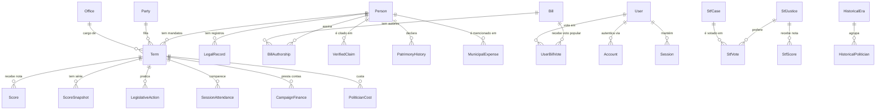

Campos principais de cada entidade do núcleo:

| Model | Campos que importam | Índice/chave |
|---|---|---|
| `Person` | `id`, `externalId?` (unique), `tseId?` (unique), `civilName`, `politicalName`, `birthYear?`, `photoUrl?` | — |
| `Party` | `acronym` (unique), `name`, `ideology?`, `position?`, `foundedYear?`, `tseNumber?`, `color?` | — |
| `Office` | `type` ("EXECUTIVE"/"LEGISLATIVE"), `name`, `jurisdiction` | — |
| `Term` | `personId`, `officeId`, `partyId?`, `startYear`, `endYear?`, `isFirstTerm`, `previousTerms` | `personId`, `officeId` |
| `Score` | `termId`, `version`, `finalScore`, `confidenceScore`, `reliabilityStatus`, `integrityScore`, `productivityScore`, `transparencyScore`, `costEfficiencyScore?`, `calculatedAt` | `termId`, `finalScore` |
| `ScoreSnapshot` | `termId`, `snapshotDate`, `finalScore`, `confidenceScore`, `reliabilityStatus`, `breakdown Json?`, `events Json?` | unique `[termId, snapshotDate]` |
| `Bill` | `externalId?` (unique), `title`, `type?`, `status?`, `date?`, `tags Json?`, `fullText?`, `simpleSummary?`, `citizenImpact?`, `keyPoints Json?` | `externalId`, `type`, `date` |
| `BillAuthorship` | `billId`, `personId`, `type?` | unique `[billId, personId]` |
| `LegislativeAction` | `termId`, `actionType`, `billId?`, `proposicaoId?`, `voteDirection?`, `isSecretVote`, `date?` | unique `[termId, actionType, billId]` |
| `SessionAttendance` | `termId`, `sessionDate`, `sessionType?`, `present`, `externalId?` | unique `[termId, sessionDate, externalId]` |
| `CampaignFinance` | `termId`, `year`, `totalReceived`, `totalSpent`, `donorCount`, `topDonors Json?`, `source` | unique `[termId, year]` |
| `PoliticianCost` | `termId`, `category`, `year`, `amount`, `description?`, `source`, `sourceUrl?` | unique `[termId, category, year, description]` |
| `PatrimonyHistory` | `personId`, `electionYear`, `declaredValue`, `assetCount`, `source` | unique `[personId, electionYear]` |
| `LegalRecord` | `personId`, `type` (enum), `status` (string), `court?`, `sourceUrl` (obrigatório), `retrievedAt` | `personId` |
| `User` | `email?` (unique), `password?` (bcrypt), `termsVersion?`, `termsAcceptedAt?`, `politicalConsentVersion?`, `politicalConsentAt?`, `politicalConsentWithdrawnAt?` | — |
| `UserBillVote` | `userId`, `billId`, `vote` ("FAVOR"/"CONTRA") | unique `[userId, billId]` |
| `RetificationRequest` | `protocolo` (unique), `requesterName`, `requesterEmail`, `targetType`, `description`, `sourceUrl?`, `status` | `requesterEmail` |
| `StfJustice` | `name` (unique), `birthYear?`, `appointedBy?`, `appointmentDate?`, `active` | — |
| `StfCase` | `externalId?` (unique), `title`, `category?`, `status?`, `decisionDate?` | — |
| `StfVote` | `justiceId`, `caseId`, `voteDirection`, `wasRapporteur`, `dissent`, `voteDate?` | unique `[justiceId, caseId]` |
| `StfScore` | `justiceId`, `periodStart`, `periodEnd`, `finalScore`, `confidenceScore`, `productivityScore`, `consistencyScore`, `transparencyScore`, `integrityScore (default 50)` | unique `[justiceId, periodStart]` |

### Duas ausências que são decisão, não esquecimento

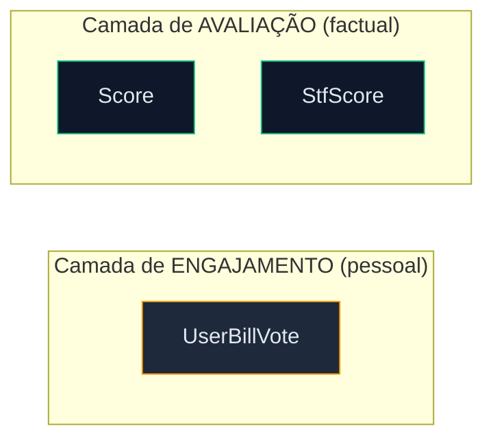

**Não existe aresta** entre `UserBillVote` e `Score`/`StfScore`. A neutralidade
algorítmica é uma propriedade do schema — ver [ADR-011](ADR.md#adr-011).

---

## 2. Sequência — cálculo do IDIP

Fluxo completo, do dado bruto ao número que a interface exibe. Separado em dois
momentos: **cálculo** (pipeline, offline) e **leitura** (runtime, por requisição).

### 2.1 Cálculo (offline — operador dispara)

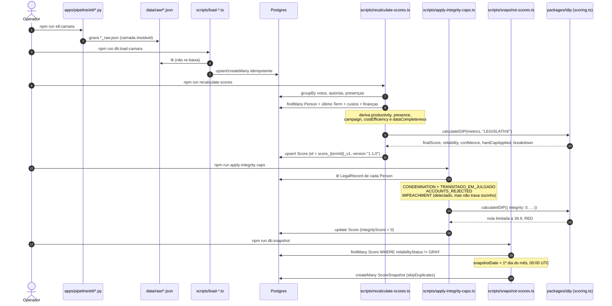

**Pontos de atenção verificados:**

- O ETL Python **nunca** escreve no banco; o load TS nunca re-baixa dado
  ([ADR-010](ADR.md#adr-010)).
- `apply-integrity-caps` roda **depois** do recálculo — rodar antes não tem efeito.
- Snapshots **excluem GRAY**: baseline provisório não vale como histórico.
- A data do snapshot é o **1º dia do mês em UTC**, não o último dia (correção de
  duplicata e de data futura — `AUDITORIA_PRODUCAO.md` §0.3).

### 2.2 Leitura (runtime — por requisição)

```mermaid
sequenceDiagram
    autonumber
    actor U as Usuário
    participant MW as middleware.ts (Edge)
    participant Page as Server Component
    participant Prisma as Prisma Client
    participant Pool as Supabase pooler (6543)
    participant DB as Postgres

    U->>MW: GET /ranking
    MW->>MW: headers de segurança (CSP, X-Frame-Options, nosniff…)
    Note over MW: rate limit só em /api/* (60/min; 10/min em auth)
    MW->>Page: NextResponse.next()
    Page->>Prisma: score.findMany({ confidenceScore >= 60, orderBy finalScore desc })
    Prisma->>Pool: query (connection_limit=1, transaction mode)
    Pool->>DB: —
    DB-->>Page: linhas
    Page->>Page: partição ranked / insufficient + slice (PAGE_SIZE 100)
    Page-->>U: HTML (RSC)
```

### 2.3 A regra de corte, em fluxo

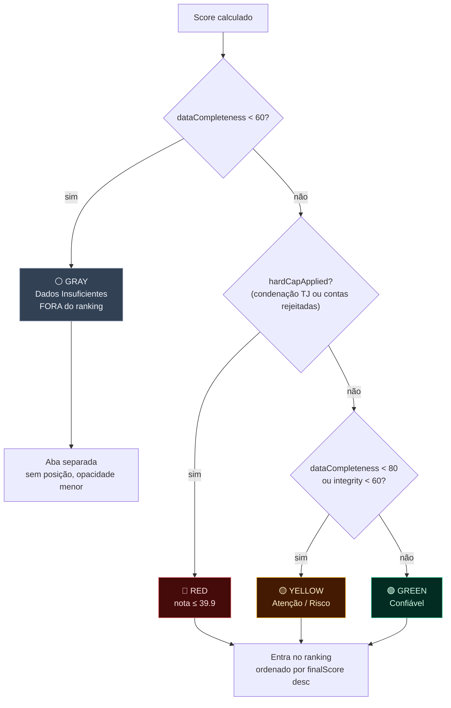

Precedência **GRAY → RED → YELLOW → GREEN**: o primeiro que casar vence.
`RED` **entra** no ranking (com nota travada em 39.9); apenas `GRAY` fica fora.
Detalhamento em [SCORING_METHODOLOGY.md §4.5 e §5](SCORING_METHODOLOGY.md).

---

## 3. Sequência — travas de integridade em detalhe

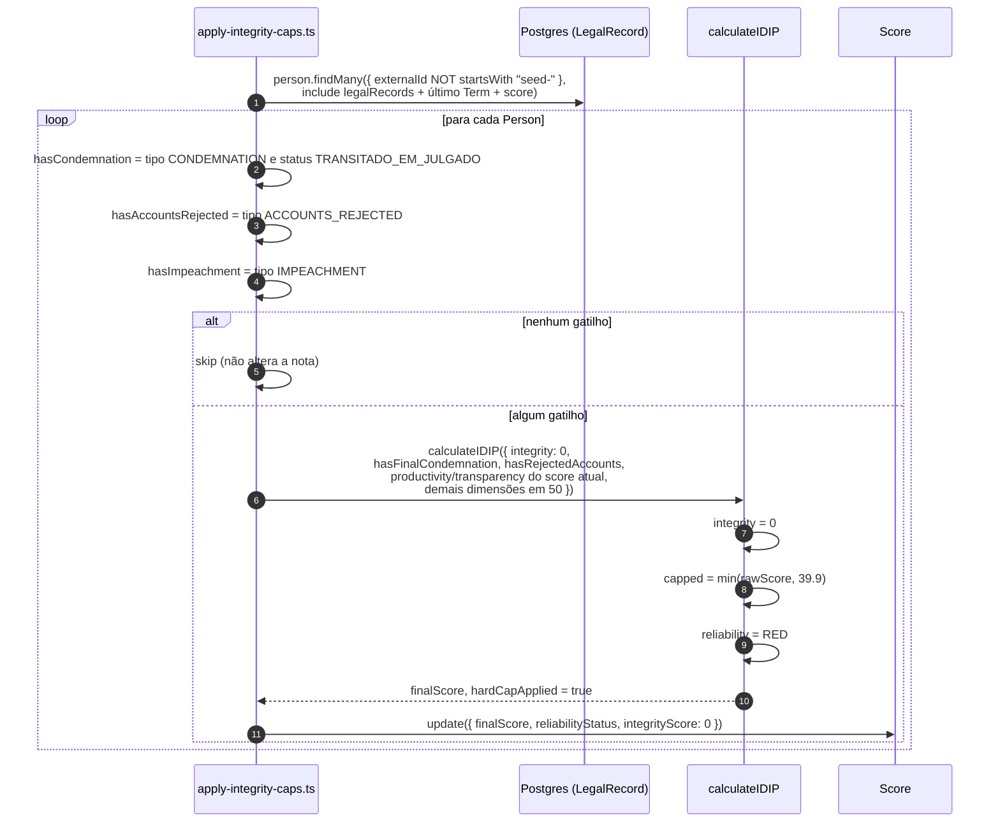

**Furo conhecido, visível no diagrama:** `hasImpeachment` é detectado mas **não é
passado ao motor** — a trava só dispara se condenação ou contas rejeitadas também
existirem. Ver [SCORING_METHODOLOGY.md §4.2](SCORING_METHODOLOGY.md) e
[ROADMAP A3](../01-product-discovery/ROADMAP.md).

---

## 4. Fluxo de ETL (pipeline completo)

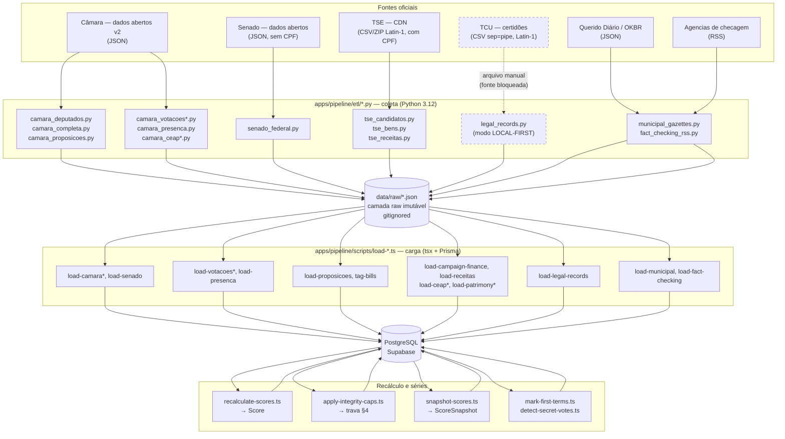

**Linhas tracejadas** são os pontos de bloqueio real, não de estilo: o ETL
jurídico (TCU/STF) opera em modo *local-first*, esperando que um humano deposite o
arquivo em `data/raw/`. É a razão de `LegalRecord` ter 0 registros.

### 4.1 Ordem obrigatória de execução

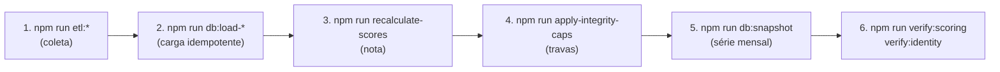

Inverter 3 e 4 faz o recálculo sobrescrever a trava. Inverter 4 e 5 faz o
snapshot guardar o estado antes da trava — e GRAY nunca entra no snapshot, mas um
RED resultante da trava entraria com nota errada.

---

## 5. Fluxo de resolução de identidade

`packages/idip/src/identity.ts` — cruza parlamentar (Câmara/Senado) com
candidatura do TSE.

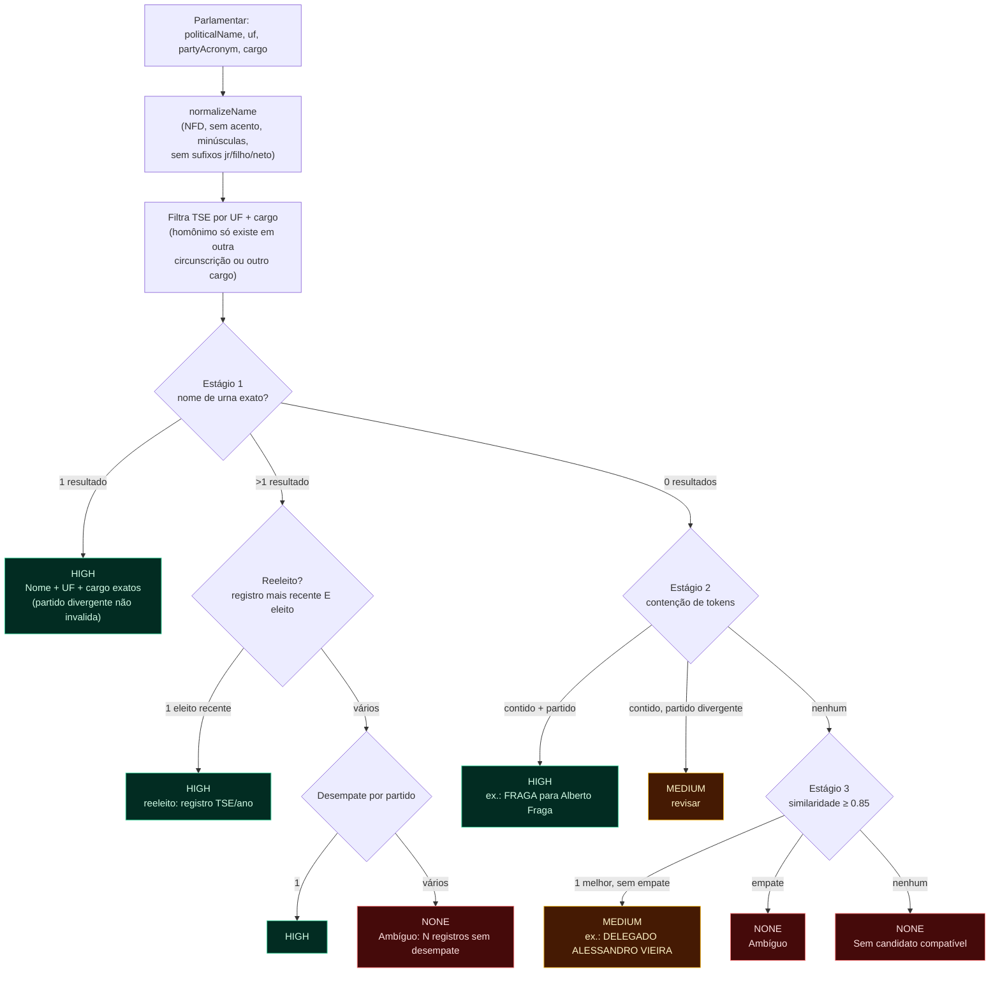

A similaridade final é `max(containment, jaccard, levenshtein_normalizado)`.
`containment` é limitado a 0.5 quando o nome menor tem apenas 1 token — evita que
"Silva" seja semelhante a qualquer pessoa. Testado por
`apps/pipeline/scripts/verify-identity.ts`.

**Uso atual e limite:** este motor resolve a **identidade eleitoral**
(TSE), não o casamento de registros jurídicos. O casamento do TCU
(`load-legal-records.ts`) usa apenas `normalizeName` **exato** — deliberadamente
mais conservador, porque um falso positivo ali é risco jurídico direto.

---

## 6. Fluxo de autenticação, consentimento e votação

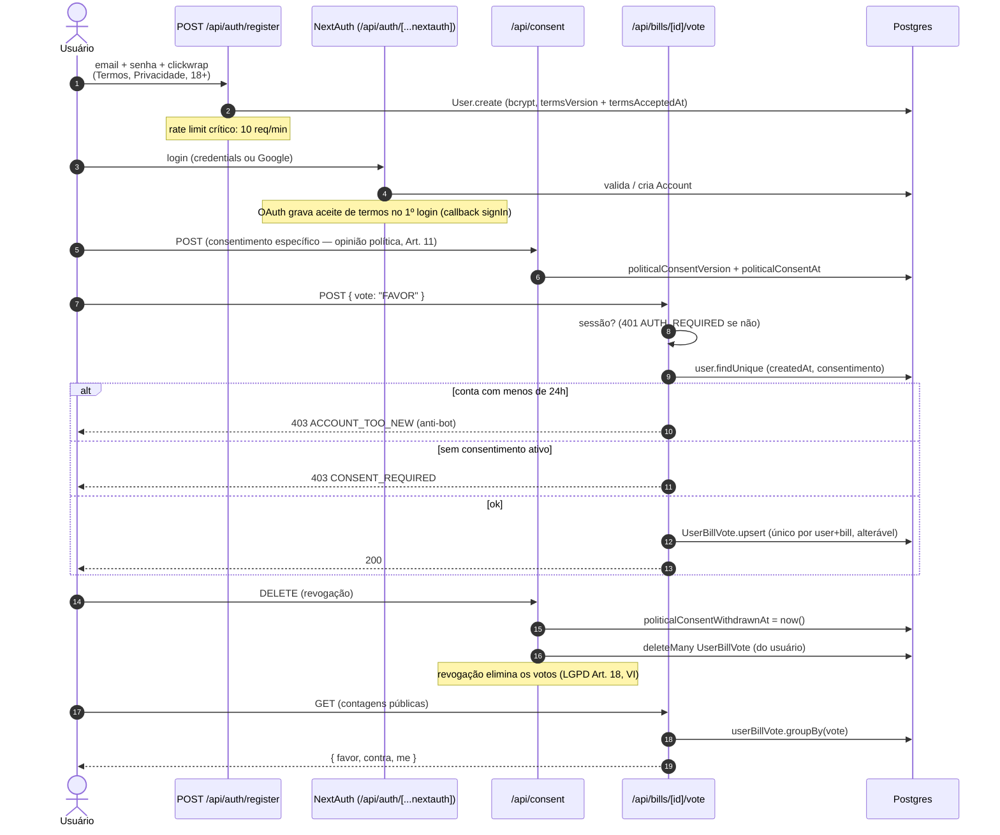

---

## 7. Fluxo de SEO (sitemap e robots)

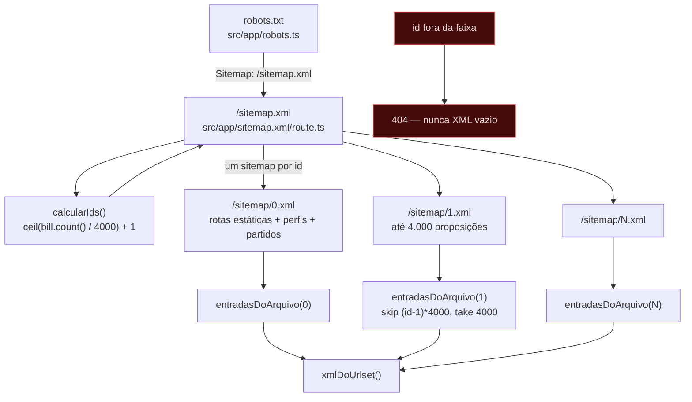

Contrato de falha: se o banco estiver indisponível, `calcularIds()` devolve ao
menos `[0]` e `entradasDoArquivo(0)` devolve as rotas estáticas — o índice
continua válido apontando para o arquivo base. Ver [ADR-009](ADR.md#adr-009).

---

## 8. Deployment e integração contínua

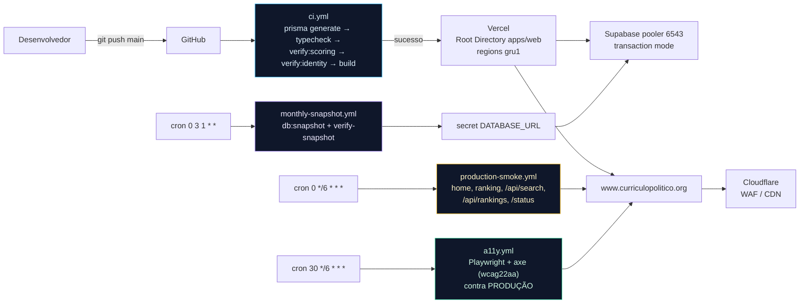

---

## 9. Notas de manutenção

1. Os diagramas descrevem o estado atual. Ao mudar o pipeline ou o motor,
   atualize o diagrama **no mesmo PR** — diagrama desatualizado é pior que
   ausente, porque é lido como verdade.
2. O diagrama de entidades permite `erDiagram` do Mermaid, que não suporta todos
   os campos; por isso a tabela de campos logo abaixo dele existe.
3. Os blocos `style` usam cores próximas dos tokens do projeto
   (`slate-950`/`emerald`/`amber`/`red`), apenas para leitura no GitHub — **não**
   são tokens de design e não devem ser reutilizados na UI.
4. Os estados do Termômetro derivam de `enum ReliabilityStatus`
   (`apps/web/prisma/schema.prisma`). A aparência real está em
   `apps/web/src/lib/status-visual.ts` — não replique as cores daqui em
   componente.

## 10. Referências

- [DATA_MODEL.md](DATA_MODEL.md) — descrição textual de cada model.
- [SCORING_METHODOLOGY.md](SCORING_METHODOLOGY.md) · [STF_SCORING.md](STF_SCORING.md)
- [ARCHITECTURE.md](ARCHITECTURE.md) · [ADR.md](ADR.md)
- `apps/web/prisma/schema.prisma` · `apps/pipeline/README.md` · `apps/pipeline/scripts/recalculate-scores.ts`
- `packages/idip/src/identity.ts` · `packages/idip/src/scoring.ts`
